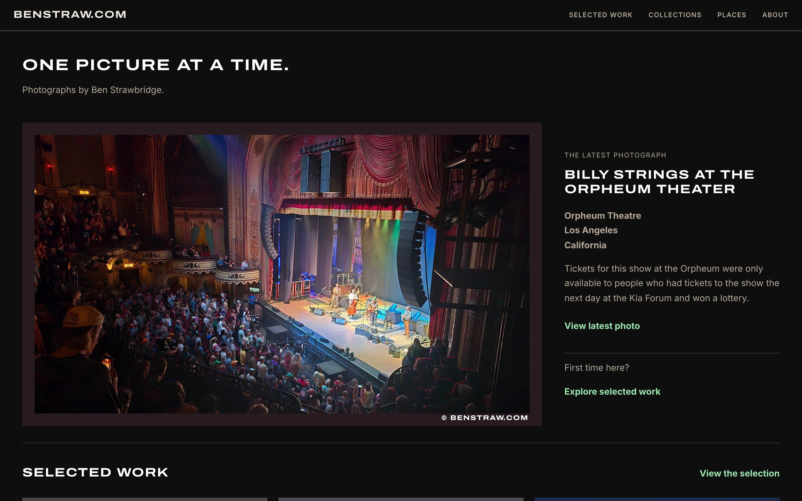

+++
title = 'benstraw.com Has a New Look'
date = 2026-11-03T08:00:00-08:00
hideAsideBar = true
description = "My photography site benstraw.com has a new look: a dark, photo-first home page that opens on the latest photograph, with collections, places and a journal."
summary = "My photography site, benstraw.com, has a new look. Come see it, one picture at a time."
homeFeatureIcon = "fa-solid fa-camera"
cardType = "-image"
cardImage = "benstraw-com-desktop.jpg"
cardImageAlt = "The benstraw.com home page: the heading \"One picture at a time\" above a photo of Billy Strings on stage at the Orpheum Theatre in Los Angeles"
cardImagePosition = "top"
tags = [
  "photography",
  "hugo",
  "arts-link",
  "web-development"
]
+++

My photography site, [benstraw.com](https://www.benstraw.com/), has a new look. Come see it, one picture at a time.

<!--more-->

It opens on the latest photograph and branches out into collections, places and a journal. [Take a look](https://www.benstraw.com/).
