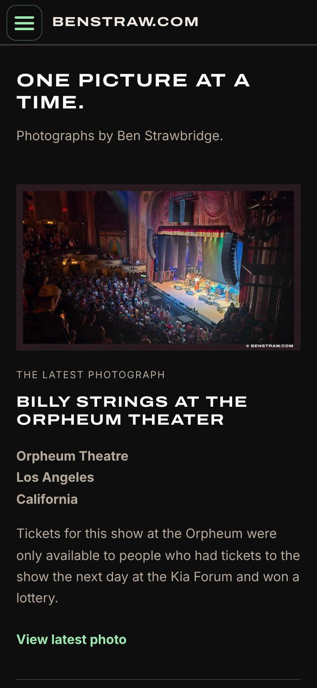

+++
title = 'benstraw.com, Redesigned: One Picture at a Time'
date = 2026-11-03T08:00:00-08:00
hideAsideBar = true
description = "My photography site benstraw.com has a new look: a dark, photo-first home page, one page per photograph, collections and places, and a 96+ Lighthouse score."
summary = "My photography site, benstraw.com, has a new look. It's darker, quieter, and built around one idea: every photograph gets its own page."
homeFeatureIcon = "fa-solid fa-camera"
cardType = "-image"
cardImage = "benstraw-com-desktop.jpg"
cardImageAlt = "The benstraw.com home page: the heading \"One picture at a time\" above a photo of Billy Strings on stage at the Orpheum Theatre in Los Angeles"
cardImagePosition = "top"
tags = [
  "photography",
  "hugo",
  "arts-link",
  "web-development"
]
+++

My photography site, [benstraw.com](https://www.benstraw.com/), has a new look. It's darker, quieter, and built around one idea: every photograph gets its own page.

<!--more-->

## What's on the home page

The home page leads with the latest photograph. Right now that's Billy Strings at the Orpheum Theatre in downtown Los Angeles, a show you could only get into if you already had tickets for the next night at the Kia Forum and won a lottery. Below it are Selected Work, for anyone who wants the short version, and four collections for anyone who wants to wander:

| Collection | What's in it |
| --- | --- |
| Land & Light | Wide open places, changing skies, and the light that makes me stop |
| Small Discoveries | Mushrooms, birds, plants, and small things worth a closer look |
| On the Street | Buildings, signs, public art, and the things a city leaves in plain sight |
| Along the Way | Dogs, sketchbooks, roadside stops, and the rest of the day |

Places, Topics, All Photos and a Journal hold the full archive.

## One gallery, one photograph

The site started from the Galleries Deluxe theme for Hugo. I reworked it so each gallery holds a single photograph. That sounds like a step backwards for a gallery theme, but it means every picture can carry its own date, topics, places and, sometimes, a story, and every picture has a URL I can send to someone.

## Fast without trying to look fast

The parts I'm proudest of are the ones you shouldn't notice:

- **The layout never jumps.** The grids use Pig.js justified rows, but Hugo works out each row's geometry at build time and ships it as CSS, so cumulative layout shift is zero. Each tile shows a gradient of its photo's dominant colors until the image arrives.
- **It works without JavaScript.** Every photo is a real link with a `<picture>` element (watermarked WebP and JPEG, with `srcset` and `sizes` per tile) in the HTML.
- **Every published image is watermarked at build time**, so the unwatermarked originals never leave my machine.
- **It's measured.** Three-run Lighthouse medians score 96 or higher on every page type, mobile and desktop, across performance, accessibility, best practices and SEO.

Like this site, it's served by Cloudflare and rebuilt every time I add a photo. The [About page](https://www.benstraw.com/about/) has the rest of the details.

benstraw.com is built by my studio, [arts-link](https://arts-link.com/). We make websites for artists, musicians and makers, so if you'd like one like it, [get in touch](/consulting/).
