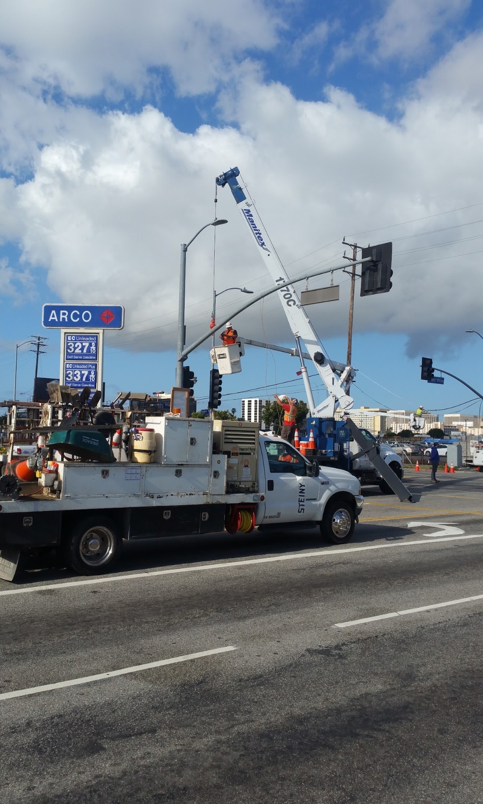
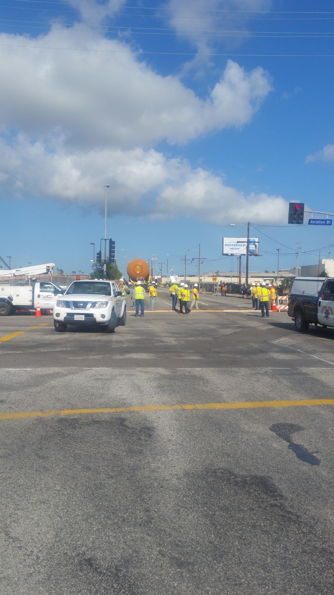
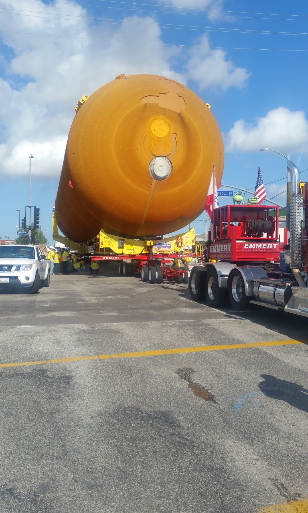
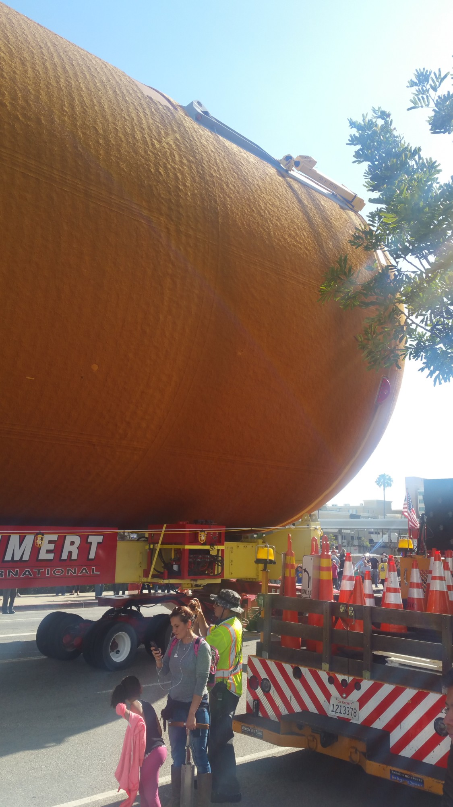
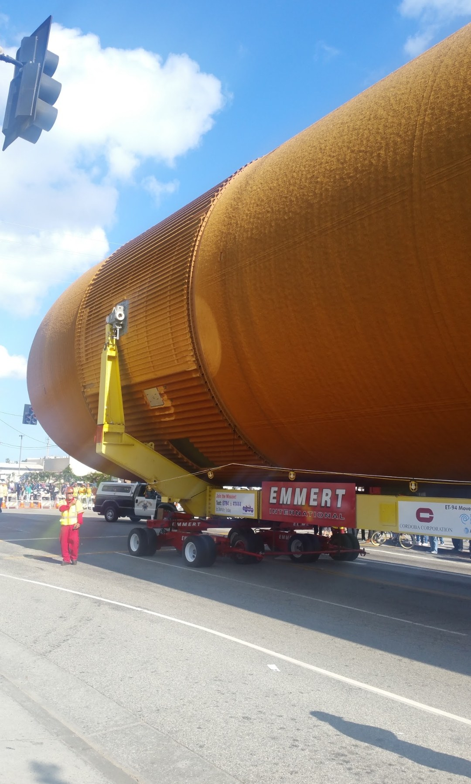
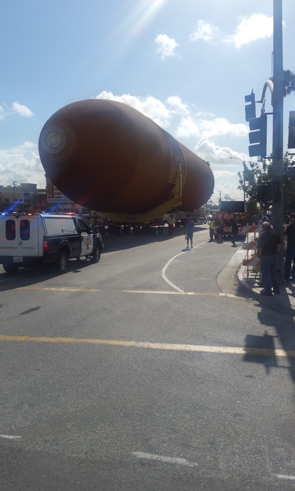

+++
title = 'The Day the Last Space Shuttle Tank Drove Across Los Angeles'
date = 2026-11-13T20:00:00-08:00
draft = false
slug = 'last-space-shuttle-tank-drove-across-los-angeles'
description = "Photos and a firsthand account of May 21, 2016, when space shuttle tank ET-94 crawled 16.5 miles across Los Angeles to join Endeavour."
summary = "In May 2016 the last space shuttle external tank rolled 16.5 miles through Los Angeles at walking pace. I chased it down early that Saturday morning with my phone. This week it went on display, standing upright beside Endeavour."
tags = [
  "space-shuttle",
  "endeavour",
  "los-angeles",
  "photography",
  "personal-history"
]
hideAsideBar = true
homeFeatureIcon = "fa-solid fa-camera"
# PREVIEW: the JPGs here are cropped phone screenshots standing in for the
# originals. Replace them (same names) before merging, then rerun
#   npm run og:generate -- --only /posts/last-space-shuttle-tank-drove-across-los-angeles/
og_image = "et94-signal-arm-crane.jpg"
cardType = "-image"
cardImage = "et94-signal-arm-crane.jpg"
cardImageAlt = "A crane truck lifts a traffic signal arm off its pole so the space shuttle tank can pass, Los Angeles, May 2016"
+++

> In May 2016 the last space shuttle external tank rolled 16.5 miles through Los Angeles at walking pace. I chased it down early that Saturday morning with my phone. This week it went on display, standing upright beside Endeavour.

<!--more-->

<!--
DRAFT NOTES — delete this block before publishing.
- Every [BEN: …] marker needs your memory or a fact only you have.
- Photos: the six image lines below are named and have alt text. Drop the
  ORIGINAL JPGs (not phone screenshots) into this folder under those names.
- Facts marked "verify" came from 2016 news coverage; numbers vary a little
  between sources (16 vs 16.5 miles, 65,000–69,000 lb, 18 vs 19 hours).
-->

*This post is written from memory and from my photographs, nearly ten years after the day. The numbers come from the news coverage at the time.*

On November 13, 2026, the California Science Center opened the Samuel Oschin Air and Space Center. Inside, Space Shuttle Endeavour stands upright, bolted to two solid rocket boosters and an orange external tank, posed as if it were about to launch. No other museum in the world shows a complete shuttle stack this way.

The biggest piece of that stack is the tank. I watched it come through the city.

## How a 154-foot tank gets to Los Angeles

The tank is called ET-94. It is about 154 feet long and 27 feet across, and it weighs roughly 66,000 pounds empty. <!-- verify diameter --> It was built at NASA's Michoud Assembly Facility in New Orleans for a shuttle flight that never happened, and it is the last flight tank still in existence. Every tank that did fly broke up over the ocean after launch. <!-- verify -->

In April 2016 it was loaded onto a barge, the *Gulfmaster I*, and towed across the Gulf of Mexico, through the Panama Canal and up the Pacific coast, more than 4,400 nautical miles. It came ashore at Marina del Rey on May 18.

That was the easy part. Exposition Park is 16.5 miles inland.

## The route

The move started just after midnight on Saturday, May 21, from the Fisherman's Village parking lot. A custom Mack truck towed the tank on a set of wheeled dollies, and the whole convoy moved at about walking pace.

The route, as published by the Science Center:

1. Fiji Way to Lincoln Boulevard, then Mindanao Way
2. The Marina Freeway (CA-90) to Culver Boulevard, and back to Lincoln
3. Loyola Boulevard, Westchester Parkway and Arbor Vitae Street, along the north edge of LAX
4. La Brea Avenue to Manchester Boulevard through Inglewood
5. Vermont Avenue to Martin Luther King Jr. Boulevard, and into Exposition Park

It arrived at the Science Center around 6:15 that evening, about 19 hours after it started.

<!-- BEN: idea for later — a tour-map of the route, like the trails use. -->

## Aviation and Arbor Vitae

A tank that size doesn't fit through a city built for cars. Crews went ahead of it closing streets, trimming trees, swinging traffic signals out of the way and lifting utility wires.

I hadn't planned to see any of it. I'd been up working late the night before, saw a news story about the tank being on the road, and decided to go. I left the house around five in the morning, since it had been moving all night and I figured it would be somewhere interesting by then.

Finding it was the hard part. Every road near the route was closed, and from a car there was no getting close. I started down by the Marina, where it had already left, and drove around looking at the crowds at a few different spots. Eventually I stopped chasing it and tried to get ahead of it. The route ran along the north side of LAX, not far from where I live, so I worked out roughly when it would reach Aviation Boulevard and Arbor Vitae Street, parked about ten blocks away and walked in. There was already a crowd on the sidewalk when I got there.

At 8:19 in the morning, a crane truck was lifting a traffic signal arm off its pole on the corner by the ARCO. Regular was $3.27 a gallon.

By 8:40 the intersection was clear: signal arms down, a line of crew in hard hats and safety vests across Aviation, and the tank waiting a few blocks down the street.

It felt like watching a marathon: no stands or stage, just people lined up along both sides of the street for as far as I could see. It was a Saturday, and it looked like half the neighborhood had come out. Nobody quite knew what to expect, and there was some real tension in the crowd while the crews worked. People cheered at the small victories, like a signal arm swinging clear, and again when the tank finally started to move.

## The turn

The straight stretches were slow. The corners were slower. Coming through Aviation and Arbor Vitae, the tank rode on two sets of wheeled dollies, one under each end, with crew walking beside each set and crouching under the frame to watch the wheels.

Getting around the corner took a long series of moves, forward a little, back a little, the front and back ends adjusted separately, over and over. On one side it came within what looked like inches of the trees. I didn't keep count. Every corner on the route was a job, but this one looked like one of the hardest on the stretch I saw.

Up close the tank isn't smooth. The orange is spray-on foam insulation, dimpled like the skin of an orange, with seams where the sections were joined.

Even with the signal arms gone, it cleared the remaining signal heads by what looked like a few feet.

By 8:50 it was through, rolling east on Arbor Vitae behind a Highway Patrol truck, and the crane trucks were already moving on. As it went, people on the curb high-fived the crew and handed out bottles of water, and for a few minutes the corner felt like a block party.

## Standing it up

The tank waited at the Science Center for years while the new building was planned. In 2024 it was lifted upright with the boosters, and Endeavour was hoisted on and mated to it. The building was then finished around the stack, which is the part I still find hard to picture: a museum built around a spacecraft, not the other way round.

I haven't been inside the new center yet. It opened on November 13, and I haven't made it there. I did visit Endeavour in its earlier home, the pavilion where it sat horizontally for years, and even lying down it's enormous. It barely seemed to fit in that building.

<!-- BEN: 3-4 photos of Endeavour from the earlier pavilion go here. Name them
     endeavour-pavilion-1.jpg etc. and they'll get alt text when they arrive. -->

Standing upright, the full stack is nearly 20 stories tall. Visitors ride a gantry-style elevator about 140 feet up the stack and come back down a slide. When I finally go, I'll be looking for the tank I watched inch around a corner by the ARCO.

## Visiting

The Samuel Oschin Air and Space Center opened November 13, 2026, at the California Science Center in Exposition Park. General admission to the Science Center, including the new center, is free. Timed reservations are strongly recommended for now because of demand, and cost $4 a person (free for members); walk-ups can get in without the fee when a time slot is open. Check [californiasciencecenter.org](https://californiasciencecenter.org/) before you go.

## Sources

- Space.com, ["Space Shuttle External Tank Completes Road Trip to CA Science Center"](https://www.space.com/32949-space-shuttle-external-tank-completes-road-trip-to-ca-science-center.html) (May 2016)
- Spaceflight Now, ["Parade moves last shuttle fuel tank to museum for Endeavour display"](https://spaceflightnow.com/2016/05/21/parade-moves-last-shuttle-fuel-tank-to-museum-for-endeavour-display/) (May 21, 2016)
- NASA JPL, ["Navigating L.A. with 65,000 pounds of NASA space shuttle history"](https://jpl.nasa.gov/edu/news/2016/5/18/navigating-la-with-65-000-pounds-of-nasa-space-shuttle-history) (May 18, 2016)
- Culver City News, ["ET-94 arrives in Marina; to journey across LA Saturday"](https://www.culvercitynews.org/?p=7873) (route)
- PR Newswire, ["Space Shuttle Endeavour Is Now Fully Stacked and Mated"](https://prnewswire.com/news-releases/space-shuttle-endeavour-is-now-fully-stacked-and-mated-completing-worlds-only-ready-to-launch-space-shuttle-display-302050052.html)
- Time Out Los Angeles, ["Here's how you can reserve your time to see Space Shuttle Endeavour in its ready-to-launch position"](https://www.timeout.com/los-angeles/news/heres-how-you-can-reserve-your-time-to-see-space-shuttle-endeavour-in-its-ready-to-launch-position-101526) (admission and reservations)
